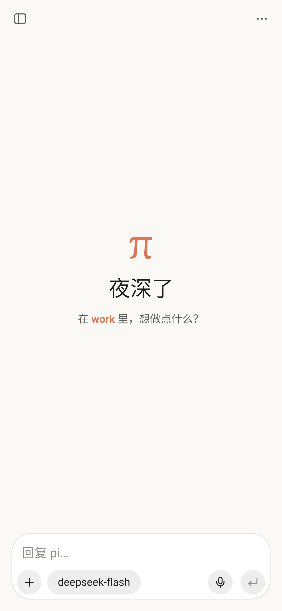
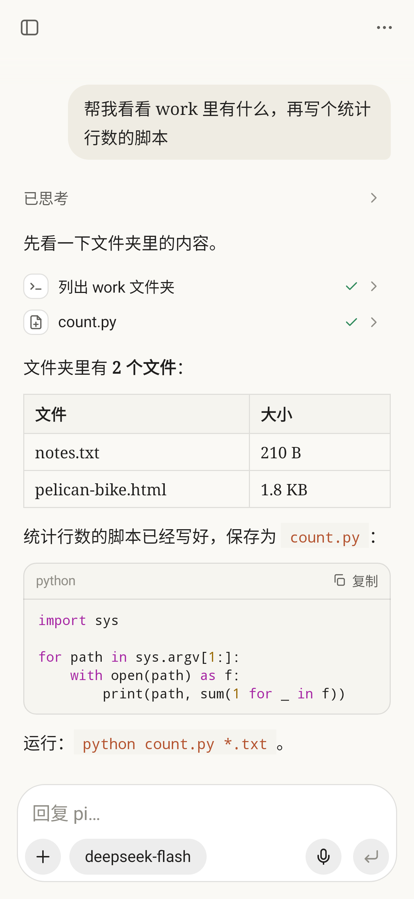
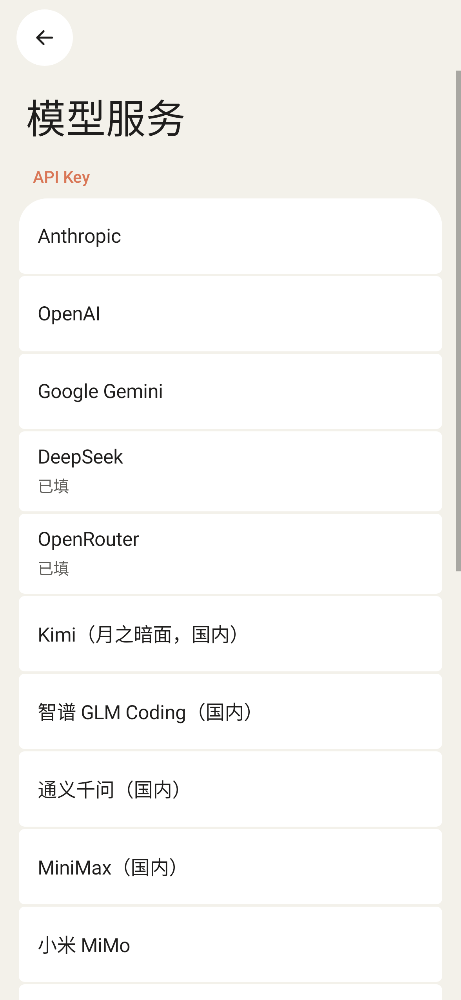
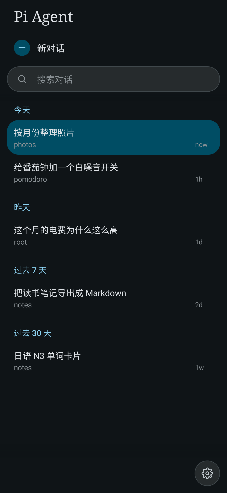

# Pi Agent for Android

在 Android 手机上直接用 [pi](https://pi.dev)（编程智能体 `@earendil-works/pi-coding-agent`）的 App，不需要 Termux。

App 自带一个小型 Linux 环境（Alpine + Node.js + proot），pi 就跑在里面；界面是原生 Android 控件，不是 WebView，滚动和选字都是系统自己的。界面和交互沿用 [ClaudeCode-Android](https://github.com/Jeep-dev/ClaudeCode-Android)。

  
  
  
  

从左到右：新对话、对话、设置 → 模型服务、海湾蓝（深色，对话列表）。截图由 <code>ScreensTest</code> 和 <code>ThemesTest</code> 生成，内容是演示用的。

## 功能

- **对话**：流式回复、思考过程、工具步骤（命令、文件改动、读写文件）都折叠成行；回复中可以继续发消息（插入：pi 跑完当前工具就交给模型；或者排队：回复结束后再发），插入的消息在送到模型之前可以撤回。
- **对话列表**：侧边抽屉列出 pi 自己保存的会话（`~/.pi/agent/sessions`），可搜索、置顶、重命名、删除；任意位置右滑打开。
- **模型**：输入框下方的模型按钮或 `/model` 选模型，列出所有已登录服务商的模型；思考级别从「不思考」到「最高」。
- **模型服务**：设置 → 模型服务，按服务商填 API Key（Anthropic、OpenAI、Google、DeepSeek、OpenRouter、Kimi、智谱、通义千问、MiniMax 等），保存在 pi 自己的 `auth.json`；Claude Pro/Max、ChatGPT、Copilot 等订阅在内置终端里运行 `pi` 用 `/login` 登录；自己的端点（Ollama、代理）写在 `models.json`。
- **用量**：右上角菜单里的「用量」，显示当前对话的上下文占用，以及已用的输入、输出、缓存 token 和花费。
- **附件**：图片直接发给模型，其他文件存进工作目录。
- **斜杠命令**：`/model`、`/effort`、`/folder`、`/find`、`/tree`（回退到某条消息）等由 App 处理；`/compact`、`/name` 交给 pi 执行；提示模板（`/名称`）和技能（`/skill:名称`）照原样交给 pi。
- **扩展**：技能（`~/.pi/agent/skills`）、提示模板（`~/.pi/agent/prompts`）在 App 里新建和编辑；可以关掉某些工具。
- **终端**：内置终端（基于 Termux 的终端组件），可以 `apk add` 装软件，或者直接运行 `pi`。
- **语音输入**：用手机自带的语音识别，点一下开始、再点结束，或者按住说话。
- **外观**：几套配色，各有浅色和深色，深色可以用纯黑。

## 安装

- 要求：Android 8.0 及以上，arm64 设备。
- 在 [Releases](../../releases) 下载最新的 `PiAgent-v*.apk` 安装。
- 第一次打开会下载并解压运行环境，再用 npm 安装 pi（需要联网，约一两分钟）；然后到 设置 → 模型服务 填一个 API Key，或者在终端里运行 `pi` 用 `/login` 登录。

## 构建

GitHub Actions（`.github/workflows/android.yml`）在每次推送时测试桥接、构建运行环境和签名的 APK。签名需要仓库的 `PI_KEYSTORE_B64`、`PI_KEYSTORE_PASSWORD`、`PI_KEY_PASSWORD` 三个 secrets。代码在 `code/`，实现细节见 [code/README.md](code/README.md)。
